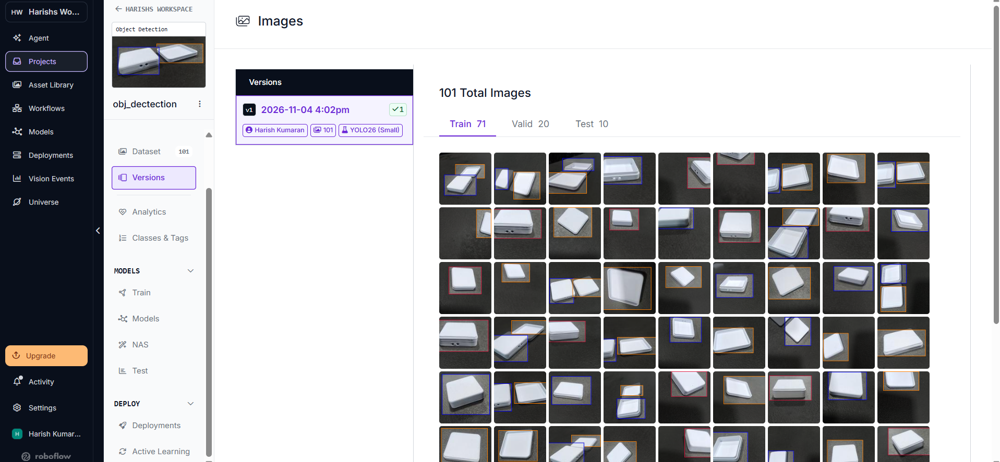
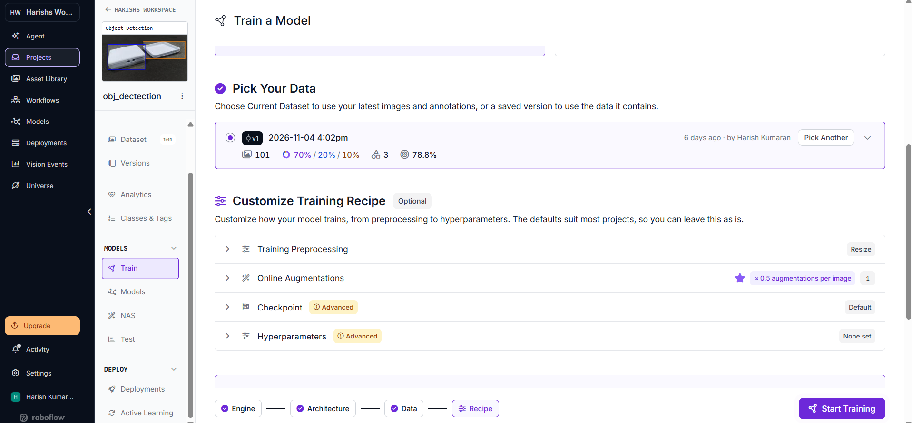
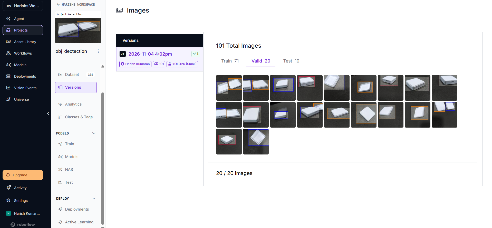
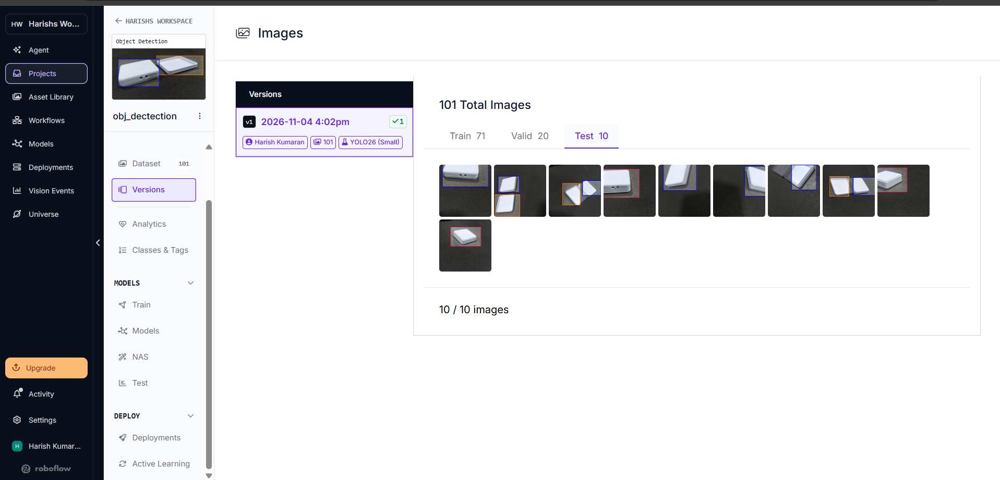
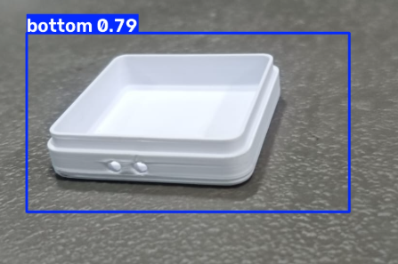
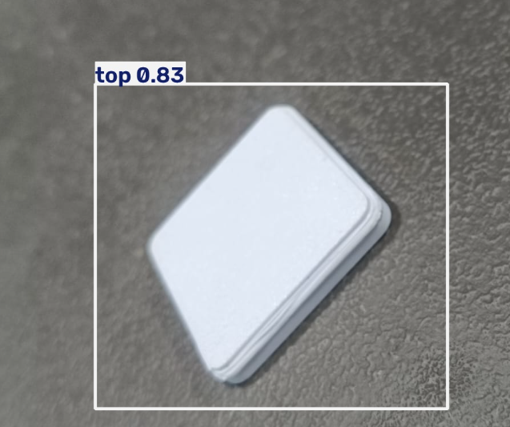

# Milestone 1: Baseline Implementation

| **Camera and repo** | **Link** | **OpenCV pipeline** | **Link** | **Baseline speed** | **Link** | **Dataset v1** | **Link** | **Correct split** | **Link** | **Train and run detector** | **Link** |
| :-----------------: | :------: | :-----------------: | :------: | :----------------: | :------: | :------------: | :------: | :---------------: | :------: | :------------------------: | :------: |
| Camera setup & repository | [View](#1-camera-and-repo) | OpenCV processing pipeline | [View](#2-opencv-pipeline) | CPU baseline performance | [View](#3-baseline-speed) | Roboflow Dataset v1 | [View](#4-dataset-v1) | Train/Valid/Test split | [View](#5-correct-split) | Training & detector execution | [View](#6-train-and-run-detector) |

---

## 1. Camera and Repo

### Purpose & Setup
This section demonstrates the hardware camera capture setup and workspace repository architecture for the 3D Load Cell Enclosure detection system.

- **Vision Sensor:** Laptop HD Webcam / UVC compliant video capture device.
- **Operating Resolution:** $1280 \times 720$ (16:9 widescreen format).
- **Mounting:** Fixed overhead workstation stand facing perpendicular down to the enclosure inspection surface.
- **Key Source Code:**
  - [`src/live_detection.py`](../src/live_detection.py): Standalone OpenCV desktop inspection window with real-time HUD.
  - [`src/app.py`](../src/app.py): Multi-threaded Flask web dashboard streaming live video and telemetry.
  - [`src/camera_calibration.py`](../src/camera_calibration.py): Camera alignment and independent sample validation tool.

### Evidence

*Explanation:* The screenshot above demonstrates the live inspection dashboard operational on the host machine. It confirms the active camera status, live telemetry connection, model checkpoint identification (`weights.pt`), and structured repository deployment.

---

## 2. OpenCV Pipeline

### Purpose & Architecture
The image processing pipeline ingests live video frames from the camera, performs noise suppression, evaluates objects with YOLO26, and filters candidate bounding boxes before rendering.

- **Frame Acquisition:** OpenCV `cv2.VideoCapture` set to $1280 \times 720$ with DirectShow backend fallback.
- **Preprocessing:** Bilateral filtering (`cv2.bilateralFilter`) to suppress camera sensor noise while maintaining sharp component edges.
- **Sub-Part Overlap Suppression:** `is_overlapping_assembled()` evaluates geometric intersection-over-part-area. If a loose `top` or `bottom` proposal overlaps an `enclosure_assembled` box by $>50\%$, it is suppressed to prevent double-counting.
- **Boundary Fitting:** Sub-pixel rotated bounding box extraction using `cv2.minAreaRect` on Otsu-thresholded and Canny edge maps.

### Evidence

*Explanation:* The capture above shows the optical stream and hardware control layer (`Start Camera`, `Stop Camera`, and stream refresh). It demonstrates real-time MJPEG frame delivery, active part isolation filters, and the integrated computer vision pipeline.

---

## 3. Baseline Speed

### Purpose & Baseline Benchmark
Evaluates the baseline inference latency, initialization overhead, and frame throughput running purely on the development host CPU.

- **Hardware Platform:** Windows 64-bit Laptop (x86_64 CPU).
- **Accelerator Status:** CPU only (No GPU, CUDA, or external tensor accelerators used).
- **Cold-Start Latency:** Approximately **7.9 seconds** (first frame Torch weight unpacking and memory allocation).
- **Steady-State Inference Latency:** Approximately **100–140 ms per frame**.
- **Approximate Throughput:** **7–10 FPS** on CPU.
- **Raspberry Pi 5 Status:** *Not completed / Not measured* (Raspberry Pi 5 hardware was not connected during this baseline test).

### Evidence

*Explanation:* The telemetry dashboard displays active inference monitoring, real-time FPS calculation, and per-class object counters (`enclosure_assembled`, `top`, `bottom`). This establishes the baseline CPU performance before edge accelerator deployment.

---

## 4. Dataset v1

### Purpose & Dataset Specifications
Documents the physical Load Cell Enclosure dataset curated, labeled, and generated through Roboflow for training the YOLO26 Small model.

- **Target Physical Enclosure:** Custom 3D mechanical enclosure ($32.0\text{ mm} \times 32.0\text{ mm}$).
- **Dataset Version:** `v1` (Generated `2026-11-04 4:02pm`).
- **Total Images:** **101** annotated photographs.
- **Number of Classes:** **3 classes** (`bottom`, `top`, `enclosure_assembled`).
- **Target Model Architecture:** YOLO26 (Small).

### Evidence

#### Overall Roboflow Dataset v1 Overview

*Explanation:* Shows dataset version `v1` containing 101 total images across 3 classes, with the Roboflow 70% / 20% / 10% partitioning.

#### Training Configuration

*Explanation:* Verifies the training launch configuration for YOLO26 (Small) on the 101-image version `v1` dataset dated 2026-11-04 at 4:02pm.

---

## 5. Correct Split

### Purpose & Partitioning Summary
Verifies the dataset partition across training, validation, and testing sets to ensure proper generalization without data manipulation.

### Split Distribution Table

| Split | Images | Roboflow Display | Exact Mathematical Ratio |
| :--- | :---: | :---: | :---: |
| **Train** | **71** | **70%** | $\approx 70.30\%$ |
| **Validation** | **20** | **20%** | $\approx 19.80\%$ |
| **Test** | **10** | **10%** | $\approx 9.90\%$ |
| **Total** | **101** | **100%** | **100.00%** |

*Academic Integrity Note:*
A cross-split hash collision analysis or independent data-leakage test was *not performed*. The split is verified based on the direct platform partition records.

### Evidence

#### Validation Split (20 / 20 Images)

*Explanation:* The `Valid` tab confirms all 20 validation images assigned to the evaluation subset.

#### Testing Split (10 / 10 Images)

*Explanation:* The `Test` tab confirms all 10 independent test images held out from training.

---

## 6. Train and Run Detector

### Purpose & Physical Detection Verification
Demonstrates empirical detection on actual physical load cell enclosure parts using the trained YOLO26 Small model ([`models/weights.pt`](../models/weights.pt)).

### Empirical Detection Confidences
- **Assembled Unit ([`datasets/test_image.jpg`](../datasets/test_image.jpg)):** `enclosure_assembled` detected at **85.8%** confidence.
- **Bottom Base ([`datasets/bottom_pic.png`](../datasets/bottom_pic.png)):** `bottom` detected at **78.9%** confidence.
- **Top Cover ([`datasets/top_pic.png`](../datasets/top_pic.png)):** `top` detected at **83.1%** confidence.
- **Simultaneous Components ([`datasets/top and bottom pic.png`](../datasets/top%20and%20bottom%20pic.png)):** `bottom` detected at **85.6%** and `top` detected at **72.4%** simultaneously without cross-class confusion.

### Evidence Pictures

#### Bottom Detection

*Explanation:* Captures the individual lower enclosure base (`bottom`) placed on the evaluation surface, correctly isolated with 78.9% confidence.

#### Top Detection

*Explanation:* Captures the individual upper protective enclosure cover (`top`), detected with 83.1% confidence.

#### Top + Bottom Detection

*Explanation:* Captures both distinct enclosure components placed side by side. The detector classifies the bottom base (85.6%) and top cover (72.4%) simultaneously without false assembly classification.
