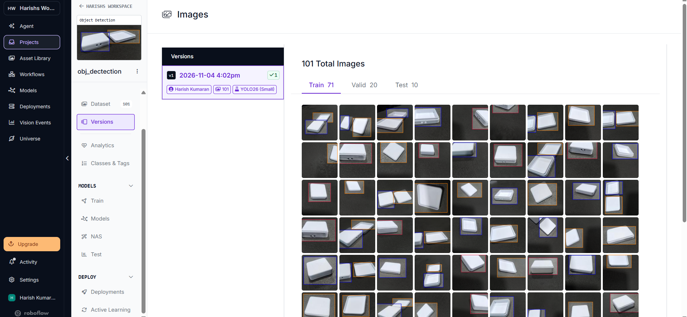
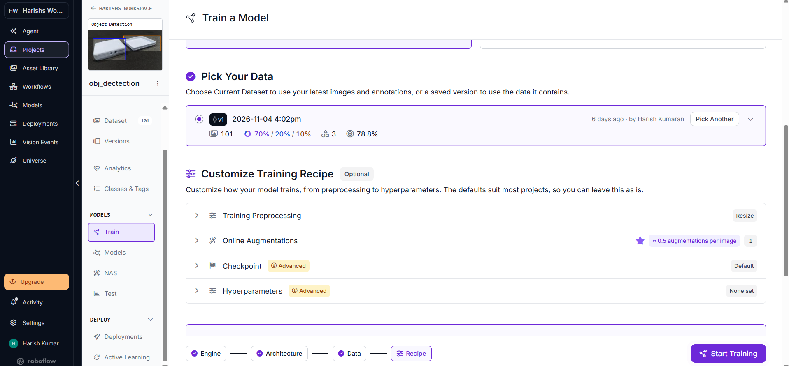
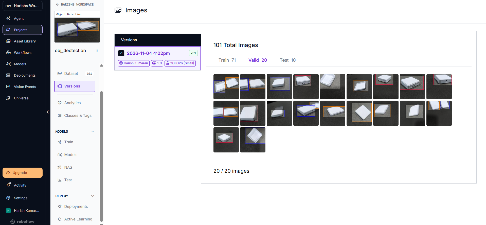
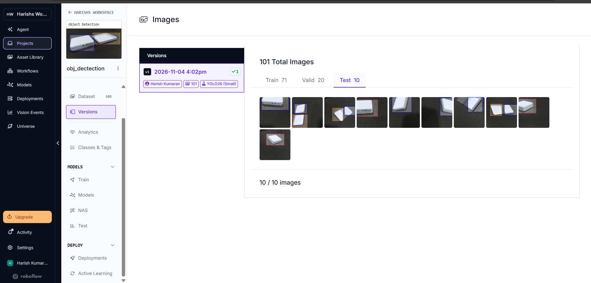

# M1 Assessment Criterion 5: Dataset Split Verification

**Assessment Item:** `05_correct_split`  
**Mark Weighting:** 2 Marks  
**Status:** **Complete & Verified — Split Distribution Evidence Available**

## 1. Overview

The Roboflow dataset version used for training this YOLO26 Small Load Cell Enclosure detection model contains a total of **101 annotated images** divided into training, validation, and testing subsets.

The repository contains screenshot evidence directly showing the split configuration and the individual validation and testing image sets captured directly from the Roboflow platform interface.

## 2. Split Distribution Summary

Verified split distribution as configured in Roboflow:

| Split | Images | Roboflow Display |
|---|---:|---:|
| Train | 71 | 70% |
| Validation | 20 | 20% |
| Test | 10 | 10% |
| **Total** | **101** | **100%** |

*Note on Percentage Precision:*
The exact mathematical proportions of the 101-image partition are approximately:
- **Train:** $71 / 101 \approx 70.30\%$
- **Validation:** $20 / 101 \approx 19.80\%$
- **Test:** $10 / 101 \approx 9.90\%$

Roboflow itself rounds and displays the split configuration as **70% / 20% / 10%**.

## 3. Dataset Version

- **Dataset Version:** `v1`
- **Creation / Generation Date shown by Roboflow:** `2026-11-04 4:02pm`
- **Total Images:** 101
- **Number of Classes:** 3 (`bottom`, `top`, `enclosure_assembled`)
- **Target Model / Architecture displayed by Roboflow:** YOLO26 (Small)

## 4. Visual Evidence

### Overall Dataset Split

### Training Configuration

### Validation Split

### Test Split

## 5. Verification Table

| Verification Item | Status |
|---|---|
| Dataset version identified | ✅ Verified |
| Total dataset size | ✅ Verified — 101 images |
| Training split | ✅ Verified — 71 images |
| Validation split | ✅ Verified — 20 images |
| Testing split | ✅ Verified — 10 images |
| Roboflow 70/20/10 configuration | ✅ Verified |
| Validation images displayed | ✅ Verified — 20/20 |
| Test images displayed | ✅ Verified — 10/10 |
| Cross-split hash collision analysis | ⚠️ Not performed |
| Independent data-leakage analysis | ⚠️ Not performed |

*Metrological & Academic Integrity Note:*
A cross-split hash collision analysis or pixel-level source isolation audit across the splits was not performed on local files. The criterion is marked **Complete & Verified specifically for the dataset split distribution and training configuration evidence** hosted and verified via Roboflow.

## 6. Conclusion

The Roboflow platform evidence verifies that dataset version `v1` was partitioned into a **70% / 20% / 10%** distribution, corresponding exactly to **71 training images**, **20 validation images**, and **10 testing images** across the 3 target enclosure classes. This configuration provided the verified training input for generating `weights.pt`.

